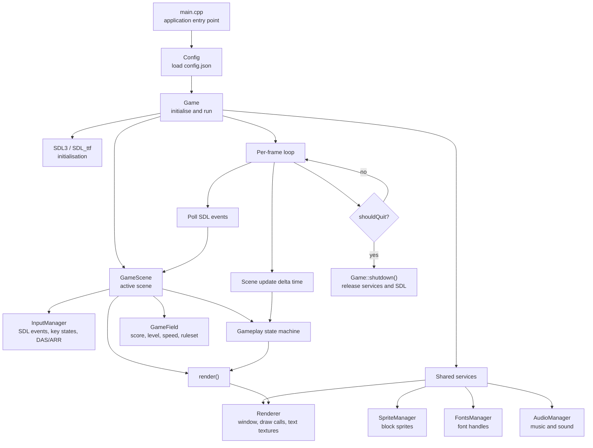
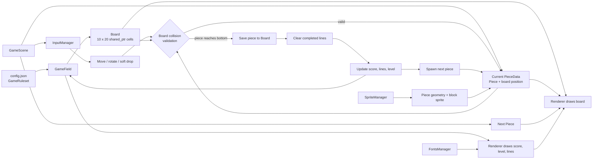

# BlockFall Architecture

The project is a small SDL3 game organized around a top-level game loop, one active scene, and a set of shared services.

## Runtime flow

## Gameplay data flow

## Main ownership boundaries

- `main()` loads configuration, then delegates lifecycle management to `Game`.
- `Game` owns the active `GameScene` and controls initialisation, frame timing, event polling, and shutdown.
- `GameScene` owns the gameplay state machine, active/preview pieces, and `InputManager`.
- `GameField` owns ruleset-derived counters and a shared `Board`.
- `Board` stores shared block sprite references in its cells; `Piece` stores shape geometry and its block sprite.
- `Renderer`, `SpriteManager`, `FontsManager`, and `AudioManager` are shared singleton services used by the scene and lifecycle code.

## Source map

| Area | Important files | Responsibility |
| --- | --- | --- |
| Entry point | `source/main.cpp` | Load configuration and start `Game` |
| Lifecycle | `source/Game/Game.*` | SDL setup, frame loop, shutdown |
| Scene | `source/Game/Scenes/*` | Scene contract and gameplay orchestration |
| Gameplay | `source/Game/GameField.h`, `source/Game/Board.h` | Ruleset state, board collision and line clearing |
| Entities | `source/Entities/*` | Pieces, blocks, and piece data |
| Input | `source/Input/*` | SDL input translation and repeat handling |
| Rendering | `source/Core/Renderer.*` | Window, drawing, and text |
| Assets | `source/AssetManagers/*` | Sprite, font, and audio loading |
| Configuration | `source/Config/*`, `config.json` | Runtime settings and rulesets |
